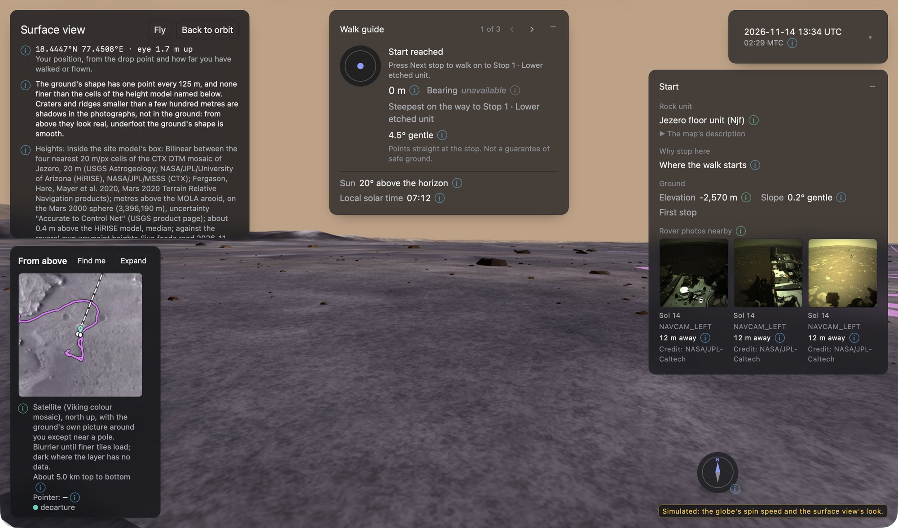
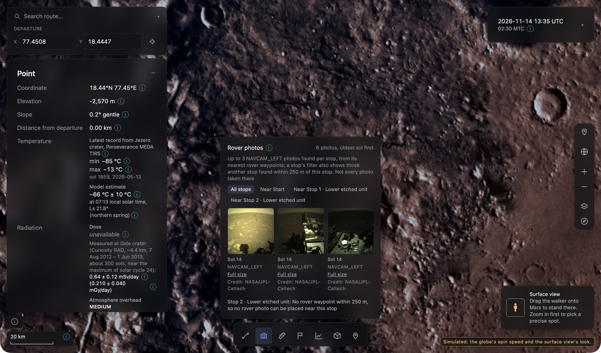

# Mars Navigator

**Plan a walk on Mars, then walk it.** Mars Navigator is a web-based mapping application
that helps users plan and follow routes across the Martian surface, focusing on 
Jezero crater, the landing site of NASA's Perseverance rover.
It is built on open NASA, USGS and ESA data, and
every figure on screen says where it comes from.

**Live:** [marsmaps.space](https://marsmaps.space) · desktop browser, no
account, no API key.

[](https://marsmaps.space)

## What it does

- **A 3D globe of Mars.** Four base layers from NASA Mars Trek: satellite,
  elevation, thermal and geology. Search for a named place, measure a
  distance, or cut a terrain profile between two points.
- **Routes over real terrain.** Pick two points and the route search finds a
  way between them over the elevation model, with its distance, slopes,
  hazards and the metabolic cost of walking it.
- **Plan a walk.** Pick a landing site on a map coloured by how flat the
  ground is, set the mission (maximum slope, samples, energy, duration), and
  get three scientific walks side by side:
  - over the flat bedrock of the crater floor;
  - from a crater rim down to the floor, across the geologic map's units;
  - to the Perseverance rover's own waypoints.

  Each walk shows its sample points, time and energy against the settings.
- **Walk it.** Follow the walk in a first-person view of the surface, built
  from official elevation models and orbital imagery, with a heads-up
  display, stop cards and the Perseverance rover's own photos taken nearby.
- **Conditions on the ground.** A modelled surface temperature through the
  Martian day, next to the rovers' own measurements at Jezero and Gale; the
  atmosphere's radiation shielding and the local solar time at a point; and
  the sun's height in the sky during the walk.

## A look inside

| | |
|---|---|
|  **Pick a landing site** on a map coloured by a rating of slope and crater |  **The walks compared**, each checked against the mission settings |
|  **Walk it** on the surface, with the walk guide, stop card and overhead map |  **The rover's own photos** near the walk's stops, next to the point's temperature and radiation |
|  **A route over real terrain**, with its hazards and elevation profile | |

## The data

Everything is read from public services at runtime or committed with its
citation. No API key is needed.

| What | Source |
|---|---|
| Base map layers | NASA Solar System Treks (Mars Trek): Viking colour mosaic, MOLA shaded relief, THEMIS day and night infrared, USGS geologic map of Mars (SIM 3292) |
| Close-up ground imagery | Mars 2020 Terrain Relative Navigation HiRISE (25 cm) and CTX (6 m) orthomosaics of Jezero, USGS; CTX global mosaic, Murray Lab, Caltech |
| Elevation | The global HRSC–MOLA blended elevation model (ESA/DLR/FU Berlin with NASA and USGS) and the official elevation models of Jezero |
| Geology of Jezero | USGS geologic map of Jezero crater (SIM 3464) |
| Rover path and photos | The Perseverance rover's traverse, waypoints and raw images, NASA/JPL-Caltech |
| Temperature | Modelled from TES thermal inertia and albedo grids (derived, ± 10 K), validated against and shown next to the rovers' measurements: MEDA at Jezero, REMS at Gale |
| Place names | USGS Gazetteer of Planetary Nomenclature |

The full list, with each product's credit, licence and limits, is in
[`DATA_SOURCES.md`](DATA_SOURCES.md).

## Scientific integrity

Every value is classified as `OFFICIAL`, `DERIVED`, `SIMULATED` or
`UNAVAILABLE`, and the interface shows which, with the source or the method.
Simulated data is always labelled as such. An unknown value is shown as
unavailable, never as zero or a guess, and a dataset's resolution is treated
as a limit: the app says what it cannot answer instead of interpolating.

## Team

[@yuryverkhov-afk](https://github.com/yuryverkhov-afk) ·
[@olezheeee](https://github.com/olezheeee) ·
[@Kavinshah03](https://github.com/Kavinshah03) ·
[@aditya300508](https://github.com/aditya300508) ·
[@chad971](https://github.com/chad971) ·
[@oreo7382](https://github.com/oreo7382)

## Tech stack

React 19 · TypeScript 6 · Vite 8 · Tailwind CSS 4 · Zustand 5 · Three.js with
React Three Fiber · oxlint · vitest. Node 24 (see `.nvmrc`).

## Quick start

```bash
npm ci
npm run dev
```

| Command | Purpose |
|---|---|
| `npm run dev` | Dev server at http://localhost:5173 |
| `npm run build` | Type-check, then production build into `dist/` |
| `npm run preview` | Serve the production build locally |
| `npm test` | Unit and integration tests (vitest) |
| `npm run lint` | oxlint |
| `npm run typecheck` | TypeScript check of the app, the tests and the config |
| `npm run check:arch` | Verify the architecture import rules |
| `npm run check:bundle` | After `build`: Three.js stays out of the first load, which stays under 500 kB |
| `npm run datum-check` | One-off report: elevation models against the rovers' own heights (needs network) |

Before committing:

```bash
npm run typecheck && npm run lint && npm test && npm run build && npm run check:arch && npm run check:bundle
```

No environment variables are required. `.env.example` lists optional
placeholders; anything prefixed `VITE_` is public once bundled.

## Deployment

The app is a static single-page build. `wrangler.jsonc` describes a
static-assets-only Cloudflare Worker: it serves `./dist` and answers unknown
paths with `index.html`.

```bash
npm run build
npx wrangler deploy
```

The deploy serves the site at `marsmaps.space` and `www.marsmaps.space`, as
custom domains: Cloudflare creates their DNS records and certificate. The
`marsmaps.space` zone has to be active in the Cloudflare account, or the
deploy fails. There is no `workers.dev` address; preview URLs stay on.

Any static host works as long as unknown paths fall back to `index.html`.
The app fetches its map tiles, elevation, geology, rover paths and photos
from public NASA and USGS services at runtime, so the browser needs network
access to them (see `DATA_SOURCES.md`).

## Project structure

| Path | Contents |
|---|---|
| `src/app/` | App shell: composes features, wires adapters to them, lays out the panels |
| `src/components/` | Shared presentational components and the design-system note |
| `src/data/` | Adapters for external formats, source descriptions, committed datasets, mock data |
| `src/domain/` | Normalized, format-agnostic model and the classification types |
| `src/features/mars-3d/` | The globe, overlays, sky and the surface view (Three.js) |
| `src/features/mission-ui/` | Panels, tools, HUD, search and navigation interface |
| `src/features/route-analysis/` | Route search, slopes, hazards, walking and temperature models |
| `src/state/` | Shared interface state (Zustand stores) |
| `src/lib/` | Generic helpers with no domain knowledge |
| `tests/` | Unit tests, integration tests and fixtures |
| `scripts/` | Architecture and bundle checks, and the scripts that rebuild committed data |
| `public/` | Static assets |
| `.github/` | CI workflow |

## Documentation

- [`ARCHITECTURE.md`](ARCHITECTURE.md): layers, import rules, state, lazy loading, how to extend
- [`DATA_SOURCES.md`](DATA_SOURCES.md): every external dataset and service, with credits and licences
- [`DEVELOPMENT.md`](DEVELOPMENT.md): conventions, testing notes and gotchas
- [`src/components/README.md`](src/components/README.md): design-system usage

## Licence

The code is released under the [MIT licence](LICENSE). The data is not ours
to license: the NASA, USGS, ESA and other datasets the app reads, the data
committed in this repository (`src/data/`, `tests/fixtures/`) and the imagery
in the screenshots keep their own terms and credits, listed in
[`DATA_SOURCES.md`](DATA_SOURCES.md).
