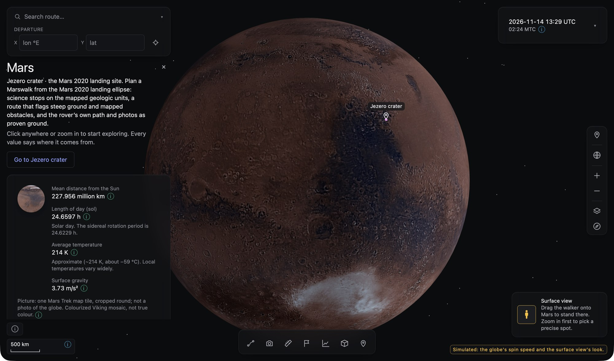
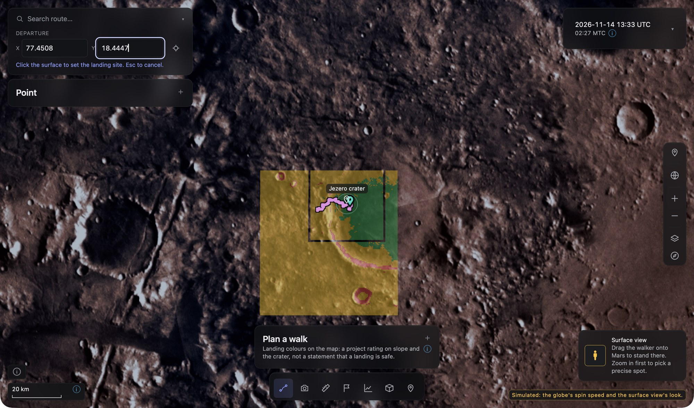
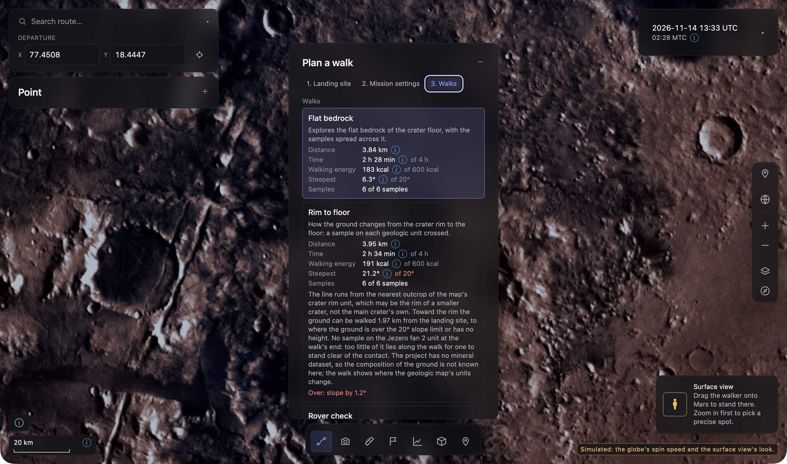
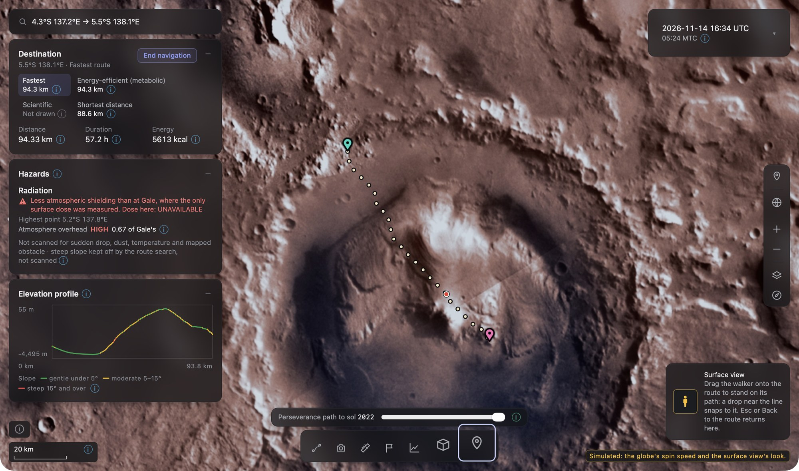

# Mars Navigator

**Plan a walk on Mars, then walk it.** Mars Navigator is a web-based mapping application
that helps users plan and follow routes across the Martian surface, focusing on 
Jezero crater, the landing site of NASA's Perseverance rover.
It is built on open NASA, USGS and ESA data, and
every figure on screen says where it comes from.

**Live:** [marsmaps.space](https://marsmaps.space) · desktop browser, no
account, no API key.

[](https://marsmaps.space)

## What it does

Mars Navigator brings together planetary mapping, terrain analysis and mission planning in a single interactive application. Users can explore the Martian surface, investigate terrain conditions, compare routes and follow planned walks using publicly available scientific datasets.

### Explore Mars in 3D

The interactive globe provides four base map layers through NASA Mars Trek: satellite imagery, elevation, thermal information and geology. Users can search for named locations, measure distances and generate terrain profiles between selected points.

### Plan routes across Martian terrain

Users select a starting location and a destination to calculate a route across the available elevation model. The route analysis reports distance, terrain slope, potential hazards and estimated metabolic energy expenditure. These measurements help users understand the physical demands and limitations of a proposed walk.

### Compare scientific walking scenarios

The mission planner allows users to choose a landing site using a map that rates terrain based on slope and crater characteristics. Users can then configure mission requirements, including maximum slope, sampling objectives, energy and duration.

The application compares three walking scenarios:

- **Crater-floor exploration:** A walk across the relatively flat bedrock of the crater floor.
- **Rim-to-floor traverse:** A route descending from the crater rim toward the floor while crossing mapped geological units.
- **Rover waypoint exploration:** A walk connecting locations associated with Perseverance's recorded traverse.

Each scenario presents sampling points and estimates of travel time and energy requirements in relation to the selected mission settings.

### Experience the surface

The first-person view allows users to follow a planned route through a representation of the Martian surface based on official elevation models and orbital imagery. A heads-up display, stop information cards and nearby Perseverance photographs provide additional context during navigation.

### Examine environmental conditions

Mars Navigator also presents environmental information relevant to surface exploration. This includes modelled surface temperature across the Martian day, comparisons with rover measurements at Jezero and Gale, atmospheric radiation shielding relative to Gale, local solar time and the Sun's elevation during a walk.

The application distinguishes scientific measurements from calculated or simulated information, allowing users to understand the origin and limitations of the displayed values.

## A look inside

| | |
|---|---|
|  **Pick a landing site** on a map coloured by a rating of slope and crater |  **The walks compared**, each checked against the mission settings |
|  **Walk it** on the surface, with the walk guide, stop card and overhead map |  **The rover's own photos** near the walk's stops, next to the point's temperature and radiation |
|  **A route over real terrain**, with its hazards and elevation profile | |

## The data

Mars Navigator combines publicly available planetary datasets from NASA, USGS, ESA and other scientific institutions. The application retrieves information from public services during runtime or uses datasets included in the repository with their corresponding source references.

No API key is required to access the application's supported public data services.

### Scientific data sources

| Category | Data source |
|---|---|
| Planetary base maps | NASA Solar System Treks (Mars Trek), including Viking imagery, MOLA shaded relief, THEMIS infrared products and USGS geological mapping |
| Detailed surface imagery | Mars 2020 Terrain Relative Navigation HiRISE and CTX orthomosaics of Jezero, together with the Caltech Murray Lab CTX global mosaic |
| Elevation models | Global HRSC–MOLA blended elevation data and official elevation models covering Jezero crater |
| Geological information | USGS geological map of Jezero crater (SIM 3464) |
| Rover navigation and imagery | NASA/JPL-Caltech Perseverance traverse data, recorded waypoints and raw rover images |
| Temperature information | Derived estimates using TES thermal inertia and albedo data, compared with MEDA and REMS measurements |
| Planetary place names | USGS Gazetteer of Planetary Nomenclature |

The temperature model has a stated uncertainty of approximately ±10 K. Its results should be interpreted as derived estimates rather than direct measurements.

Detailed references, licensing information, data limitations and scientific attribution are maintained in [`DATA_SOURCES.md`](DATA_SOURCES.md).

## Scientific integrity

Scientific transparency is an essential part of Mars Navigator. The application distinguishes between observed measurements, calculated values, simulated information and unavailable data.

Every value that may be unknown is assigned one of four classifications:

- **`OFFICIAL`:** Information obtained directly from an official scientific dataset, accompanied by its source.
- **`DERIVED`:** A value calculated using existing information and an identified method.
- **`SIMULATED`:** Information generated for demonstration purposes and explicitly identified as simulated.
- **`UNAVAILABLE`:** Information that cannot be reliably provided, displayed with an explanation rather than a fabricated number.

These classifications help prevent estimates or demonstrations from being mistaken for direct scientific observations.

### Data limitations

Scientific datasets differ in spatial resolution, geographic coverage and measurement accuracy. Mars Navigator treats these limitations as part of the information presented to users.

Where the available data cannot support a reliable answer, the application identifies the limitation instead of displaying an unsupported estimate. Unknown values are not automatically replaced with zero.

The objective is to make planetary exploration understandable while preserving a clear distinction between measured data, scientific calculations and simulated representations.

## Team

[@yuryverkhov-afk](https://github.com/yuryverkhov-afk) ·
[@olezheeee](https://github.com/olezheeee) ·
[@Kavinshah03](https://github.com/Kavinshah03) ·
[@aditya300508](https://github.com/aditya300508) ·
[@chad971](https://github.com/chad971) ·
[@oreo7382](https://github.com/oreo7382)

## Tech stack

React 19 · TypeScript 6 · Vite 8 · Tailwind CSS 4 · Zustand 5 · Three.js with
React Three Fiber · oxlint · vitest. Node 24 (see `.nvmrc`).

## Quick start

```bash
npm ci
npm run dev
```

| Command | Purpose |
|---|---|
| `npm run dev` | Dev server at http://localhost:5173 |
| `npm run build` | Type-check, then production build into `dist/` |
| `npm run preview` | Serve the production build locally |
| `npm test` | Unit and integration tests (vitest) |
| `npm run lint` | oxlint |
| `npm run typecheck` | TypeScript check of the app, the tests and the config |
| `npm run check:arch` | Verify the architecture import rules |
| `npm run check:bundle` | After `build`: Three.js stays out of the first load, which stays under 500 kB |
| `npm run datum-check` | One-off report: elevation models against the rovers' own heights (needs network) |

Before committing:

```bash
npm run typecheck && npm run lint && npm test && npm run build && npm run check:arch && npm run check:bundle
```

No environment variables are required. `.env.example` lists optional
placeholders; anything prefixed `VITE_` is public once bundled.

## Deployment

The app is a static single-page build. `wrangler.jsonc` describes a
static-assets-only Cloudflare Worker: it serves `./dist` and answers unknown
paths with `index.html`.

```bash
npm run build
npx wrangler deploy
```

The deploy serves the site at `marsmaps.space` and `www.marsmaps.space`, as
custom domains: Cloudflare creates their DNS records and certificate. The
`marsmaps.space` zone has to be active in the Cloudflare account, or the
deploy fails. There is no `workers.dev` address; preview URLs stay on.

Any static host works as long as unknown paths fall back to `index.html`.
The app fetches its map tiles, elevation, geology, rover paths and photos
from public NASA and USGS services at runtime, so the browser needs network
access to them (see `DATA_SOURCES.md`).

## Project structure

| Path | Contents |
|---|---|
| `src/app/` | App shell: composes features, wires adapters to them, lays out the panels |
| `src/components/` | Shared presentational components and the design-system note |
| `src/data/` | Adapters for external formats, source descriptions, committed datasets, mock data |
| `src/domain/` | Normalized, format-agnostic model and the classification types |
| `src/features/mars-3d/` | The globe, overlays, sky and the surface view (Three.js) |
| `src/features/mission-ui/` | Panels, tools, HUD, search and navigation interface |
| `src/features/route-analysis/` | Route search, slopes, hazards, walking and temperature models |
| `src/state/` | Shared interface state (Zustand stores) |
| `src/lib/` | Generic helpers with no domain knowledge |
| `tests/` | Unit tests, integration tests and fixtures |
| `scripts/` | Architecture and bundle checks, and the scripts that rebuild committed data |
| `public/` | Static assets |
| `.github/` | CI workflow |

## Documentation

- [`ARCHITECTURE.md`](ARCHITECTURE.md): layers, import rules, state, lazy loading, how to extend
- [`DATA_SOURCES.md`](DATA_SOURCES.md): every external dataset and service, with credits and licences
- [`DEVELOPMENT.md`](DEVELOPMENT.md): conventions, testing notes and gotchas
- [`src/components/README.md`](src/components/README.md): design-system usage

## Licence

The code is released under the [MIT licence](LICENSE). The data is not ours
to license: the NASA, USGS, ESA and other datasets the app reads, the data
committed in this repository (`src/data/`, `tests/fixtures/`) and the imagery
in the screenshots keep their own terms and credits, listed in
[`DATA_SOURCES.md`](DATA_SOURCES.md).
